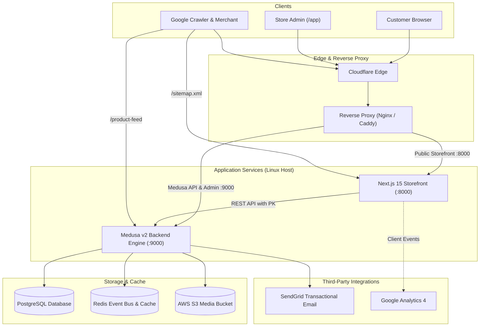

# Laptopzone Technical Documentation

Welcome to the engineering and architectural documentation for **Laptopzone** (`my-medusa-store`), a headless e-commerce platform built with **Medusa v2** and **Next.js 15 (App Router)** in a Turborepo monorepo.

This documentation serves as the single source of truth for software engineers, devops engineers, and AI coding agents working on this codebase.

---

## Documentation Map

```text
docs/
├── README.md                               # This master documentation index
├── ENVIRONMENT.md                          # Comprehensive environment variables reference
├── repository-structure.md                 # Monorepo directory map & responsibilities
├── technology-stack.md                     # Frameworks, engines, and exact dependency versions
│
├── architecture/
│   └── overview.md                         # High-level system architecture and topology
│
├── medusa/
│   └── architecture.md                     # Medusa backend, custom modules, workflows, and admin
│
├── storefront/
│   └── routing-and-components.md           # Next.js App Router, routes, and key UI components
│
├── products/
│   └── architecture.md                     # Product lifecycle, models, variants, options, S3 & pricing
│
├── seo/
│   └── architecture.md                     # Dynamic metadata, canonicals, Schema.org, sitemaps, feeds
│
├── location/
│   └── country-and-location.md             # Geolocation, clean URLs, region resolution & delivery
│
├── api/
│   └── architecture.md                     # Complete specification of store, admin, and webhook APIs
│
├── data-flows/
│   └── data-flows.md                       # Sequence diagrams for catalog, cart, checkout, and orders
│
├── integrations/
│   └── external-integrations.md            # SendGrid, AWS S3, Google Analytics & Merchant
│
├── deployment/
│   └── architecture.md                     # Production topology, systemd services, reverse proxy & ports
│
└── ci-cd/
    └── pipelines.md                        # GitHub Actions CI/CD workflows and automated deployment
```

---

## Architecture Summary at a Glance



---

## Quick Navigation

1. **[System Architecture Overview](file:///c:/Users/kundai/Desktop/projects/my-medusa-store/docs/architecture/overview.md)**: High-level overview of services, request flows, and architectural principles.
2. **[Repository Structure](file:///c:/Users/kundai/Desktop/projects/my-medusa-store/docs/repository-structure.md)**: Monorepo folder layout, Turborepo tasks, and conventions.
3. **[Technology Stack](file:///c:/Users/kundai/Desktop/projects/my-medusa-store/docs/technology-stack.md)**: Exact versions for Node, Next.js, Medusa, React, Tailwind, and plugins.
4. **[Storefront Routing & Components](file:///c:/Users/kundai/Desktop/projects/my-medusa-store/docs/storefront/routing-and-components.md)**: App router routes, dynamic segments, catalog toolbar, and UI components.
5. **[Medusa Backend Architecture](file:///c:/Users/kundai/Desktop/projects/my-medusa-store/docs/medusa/architecture.md)**: Core vs custom modules (Brand, SEO, Reviews), workflows, subscribers, and admin widgets.
6. **[Product Architecture & Lifecycle](file:///c:/Users/kundai/Desktop/projects/my-medusa-store/docs/products/architecture.md)**: Product models, variant strategies, AWS S3 image storage, and pricing engine.
7. **[SEO Architecture](file:///c:/Users/kundai/Desktop/projects/my-medusa-store/docs/seo/architecture.md)**: Dynamic metadata, Canonical URL engine, Schema.org JSON-LD, multi-sitemap, and Google Merchant Center feeds.
8. **[Country & Location Architecture](file:///c:/Users/kundai/Desktop/projects/my-medusa-store/docs/location/country-and-location.md)**: Clean URL redirection, geolocation resolution hierarchy, and planned Zimbabwean town delivery selectors.
9. **[API Architecture](file:///c:/Users/kundai/Desktop/projects/my-medusa-store/docs/api/architecture.md)**: Complete guide to all Storefront, Admin, and Webhook REST endpoints.
10. **[Data Flow Architecture](file:///c:/Users/kundai/Desktop/projects/my-medusa-store/docs/data-flows/data-flows.md)**: Sequence diagrams for catalog ingestion, cart management, checkout, and order notification dispatches.
11. **[External Integrations](file:///c:/Users/kundai/Desktop/projects/my-medusa-store/docs/integrations/external-integrations.md)**: Specifications for SendGrid, AWS S3, Google Analytics 4, and migration utilities.
12. **[Environment Variables](file:///c:/Users/kundai/Desktop/projects/my-medusa-store/docs/ENVIRONMENT.md)**: Full reference table of all backend, storefront, and CI/CD secrets and configuration flags.
13. **[Deployment Architecture](file:///c:/Users/kundai/Desktop/projects/my-medusa-store/docs/deployment/architecture.md)**: Host configuration, systemd services, reverse proxy ports, and maintenance procedures.
14. **[CI/CD Pipelines](file:///c:/Users/kundai/Desktop/projects/my-medusa-store/docs/ci-cd/pipelines.md)**: GitHub Actions continuous integration and SSH-based zero-downtime deployment workflows.
