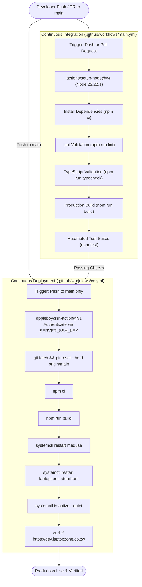

# CI/CD Pipelines

> **Automation Platform**: GitHub Actions  
> **Pipelines**: Continuous Integration (`main.yml`) & Continuous Deployment (`cd.yml`)  
> **Target Branch**: `main`

---

## 1. Automated Delivery Flow



---

## 2. Continuous Integration Pipeline (`main.yml`)

The CI workflow validates every pull request and push to ensure clean code quality, type safety, and error-free builds.

### Pipeline Configuration
- **File**: [`.github/workflows/main.yml`](file:///c:/Users/kundai/Desktop/projects/my-medusa-store/.github/workflows/main.yml)
- **Triggers**:
  - `push` to `branches: [main]`
  - `pull_request` to `branches: [main]`
- **Runner**: `ubuntu-latest`
- **Node Version**: `22.22.1`
- **Environment Injections**:
  - `NEXT_PUBLIC_MEDUSA_PUBLISHABLE_KEY`: Provided via GitHub Actions repository variables to satisfy Next.js static site generation build requirements.

### Execution Steps
1. **Repository Checkout**: Uses `actions/checkout@v4`.
2. **Node.js Initialization**: Uses `actions/setup-node@v4` with global npm dependency caching keyed against `package-lock.json`.
3. **Dependency Installation**: Runs `npm ci` for deterministic, clean dependency resolution.
4. **Code Quality Lint**: Executes `npm run lint --if-present` across all Turbo workspace packages.
5. **Static Typecheck**: Runs `npm run typecheck --if-present` to verify TypeScript types across Medusa and Next.js.
6. **Workspace Compilation**: Executes `npm run build --if-present` using Turborepo caching.
7. **Automated Testing**: Runs `npm test --if-present` to execute unit tests.

---

## 3. Continuous Deployment Pipeline (`cd.yml`)

The CD workflow automates zero-downtime deployment directly to the Linux host server via SSH upon successful merges to `main`.

### Pipeline Configuration
- **File**: [`.github/workflows/cd.yml`](file:///c:/Users/kundai/Desktop/projects/my-medusa-store/.github/workflows/cd.yml)
- **Triggers**: `push` to `branches: [main]`
- **Action Runner**: `ubuntu-latest` using `appleboy/ssh-action@v1`.
- **Required GitHub Secrets**:
  - `SERVER_HOST`: Production server IP address or domain.
  - `SERVER_USER`: Target user on the host (e.g. `root`).
  - `SERVER_SSH_KEY`: Private SSH key authorized in the server's `authorized_keys`.

### Remote Server Script Execution
```bash
set -e

cd /root/my-medusa-store

echo "=== Updating source ==="
git fetch origin
git reset --hard origin/main

echo "=== Installing dependencies ==="
npm ci

echo "=== Building applications ==="
npm run build

echo "=== Restarting Medusa ==="
sudo systemctl restart medusa

echo "=== Restarting Storefront ==="
sudo systemctl restart laptopzone-storefront

echo "=== Checking services ==="
sudo systemctl is-active --quiet medusa
sudo systemctl is-active --quiet laptopzone-storefront

echo "=== Health check ==="
curl -f https://dev.laptopzone.co.zw

echo "=== Deployment successful ==="
```

---

## 4. Failure Handling & Rollbacks

1. **Build / Compilation Failure**: If `npm run build` fails either locally or on the remote server, the deployment terminates immediately (`set -e`) before touching `systemctl restart`, leaving the existing running server processes online and untouched.
2. **Service Crash on Startup**: If a service fails to boot, `systemctl is-active --quiet` fails the workflow run and alerts developers in GitHub Actions.
3. **Health Check Failure**: The final `curl -f` ensures that the reverse proxy is successfully routing HTTP traffic and receiving a 200 OK status from the site.
