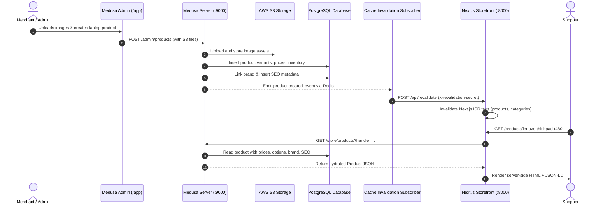
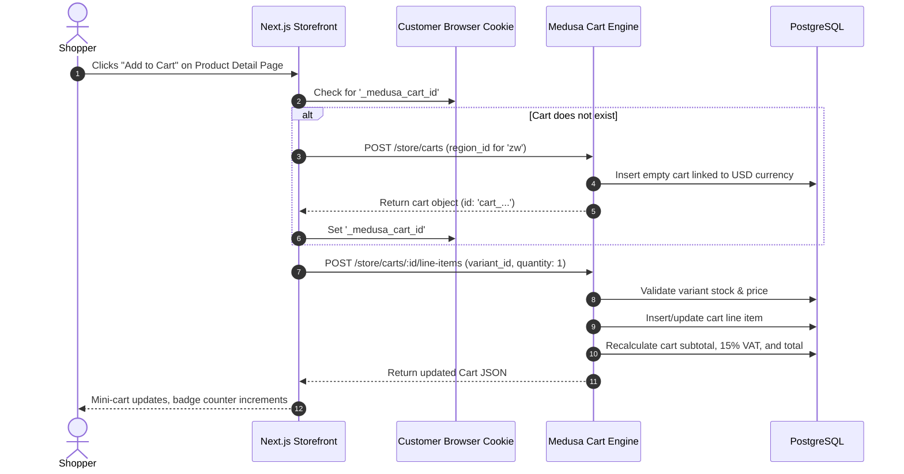
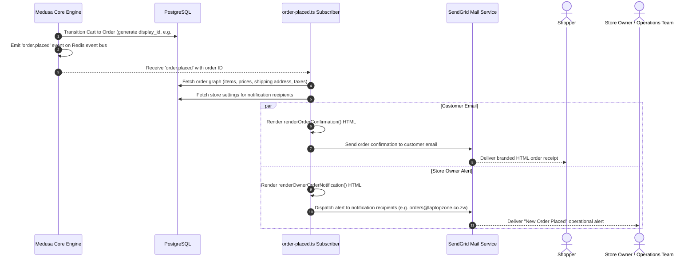
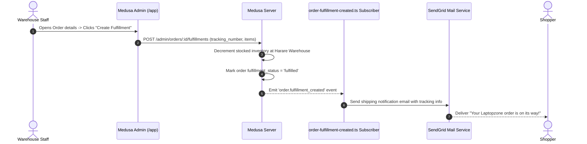

# Data Flow Architecture

> **Scope**: Detailed sequence flows and lifecycle models for Product Ingestion, Cart Management, Checkout & Payment, Order Processing & Notifications, and Cache Synchronization in Laptopzone.

---

## 1. Product Lifecycle & Catalog Flow



---

## 2. Cart Management Flow



---

## 3. Checkout & Payment Flow (Pesepay Gateway)

```mermaid
sequenceDiagram
    autonumber
    actor Customer as Shopper
    participant Storefront as Next.js Storefront
    participant Medusa as Medusa Backend
    participant PesepayProvider as Pesepay Payment Provider
    participant PesepayGateway as Pesepay API (Sandbox / Live)
    participant WebhookHandler as POST /store/pesepay/webhook

    Customer->>Storefront: Fills shipping address & selects Delivery method
    Storefront->>Medusa: POST /store/carts/:id (shipping_address)
    Storefront->>Medusa: POST /store/carts/:id/shipping-methods
    Customer->>Storefront: Chooses "Pesepay" (EcoCash, OneMoney, Card)
    Storefront->>Medusa: POST /store/payment-collections/:id/payment-sessions (provider_id: "pesepay")
    Medusa->>PesepayProvider: authorizePayment()
    PesepayProvider->>PesepayGateway: Initiates transaction with reference & returnUrl
    PesepayGateway-->>PesepayProvider: Returns redirectUrl & transaction reference
    PesepayProvider-->>Medusa-->>Storefront: Return redirectUrl
    Storefront-->>Customer: Redirect to Pesepay secure payment gateway
    Customer->>PesepayGateway: Completes PIN / OTP mobile money authorization

    par Direct Callback / Return
        PesepayGateway-->>Customer: Redirect to /payment-callback?cart_id=...&status=SUCCESS
        Customer->>Storefront: Lands on /payment-callback
        Storefront->>Medusa: POST /store/carts/:id/complete
        Medusa-->>Storefront: Returns confirmed Order object
        Storefront-->>Customer: Redirect to /order/confirmed/[id]
    and Asynchronous Webhook
        PesepayGateway->>WebhookHandler: POST /store/pesepay/webhook (AES-256 payload)
        WebhookHandler->>WebhookHandler: Decrypt payload using PESEPAY_ENCRYPTION_KEY
        WebhookHandler->>Medusa: Run processPesepayWebhookWorkflow
        Medusa->>Medusa: Verify payment status & capture payment
    end
```

---

## 4. Order Completion & Notification Flow



---

## 5. Fulfillment & Shipping Flow


