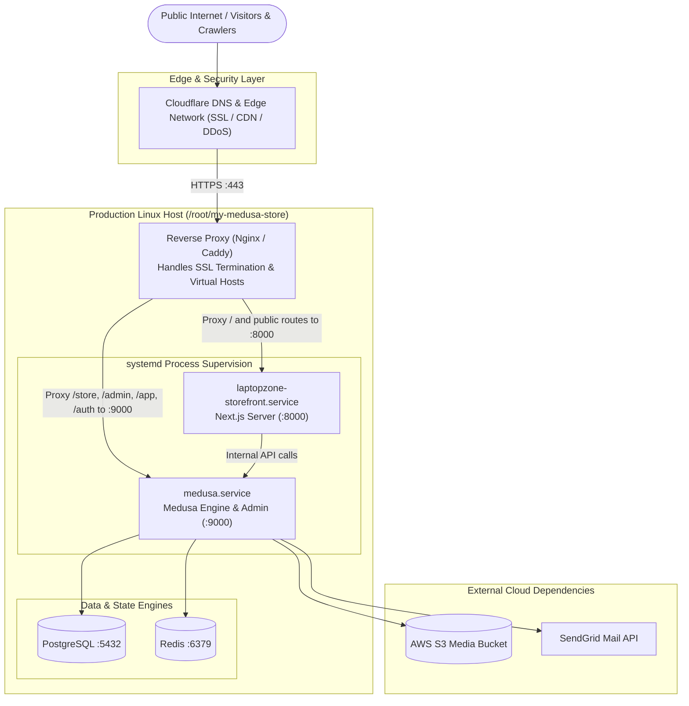

# Deployment Architecture

> **Target Environment**: Ubuntu Linux VPS / Dedicated Host  
> **Deployment Method**: Automated GitHub Actions CD via SSH  
> **Service Supervision**: `systemd`  
> **Public Domains**: `laptopzone.co.zw` (Production) & `dev.laptopzone.co.zw` (Staging / Development)

---

## 1. Production Topology & Routing Model



---

## 2. Server Specifications & Port Mapping

| Service / Component | Process Name | Listening Port | Public Domain / Path | Purpose |
|---|---|---|---|---|
| **Next.js Storefront** | `laptopzone-storefront.service` | `127.0.0.1:8000` | `https://laptopzone.co.zw/` | Customer storefront and server actions |
| **Medusa Backend** | `medusa.service` | `127.0.0.1:9000` | `https://dev.laptopzone.co.zw/` & `/app` | REST API engine and Vite Admin panel |
| **Reverse Proxy** | `nginx` or `caddy` | `:80`, `:443` | All domains | SSL termination, HTTP/2, gzip, static proxy |
| **PostgreSQL** | `postgresql.service` | `127.0.0.1:5432` | Internal only | Relational database storage |
| **Redis** | `redis-server.service` | `127.0.0.1:6379` | Internal only | Event bus pub/sub and distributed caching |

---

## 3. Systemd Service Configurations

### 3.1 Medusa Backend Service (`/etc/systemd/system/medusa.service`)
```ini
[Unit]
Description=Medusa Backend Engine
After=network.target postgresql.service redis-server.service

[Service]
Type=simple
User=root
WorkingDirectory=/root/my-medusa-store/apps/backend
ExecStart=/usr/bin/npm run start
Restart=always
RestartSec=5
Environment=NODE_ENV=production
EnvironmentFile=/root/my-medusa-store/apps/backend/.env

[Install]
WantedBy=multi-user.target
```

### 3.2 Next.js Storefront Service (`/etc/systemd/system/laptopzone-storefront.service`)
```ini
[Unit]
Description=Laptopzone Next.js Storefront
After=network.target medusa.service

[Service]
Type=simple
User=root
WorkingDirectory=/root/my-medusa-store/apps/storefront
ExecStart=/usr/bin/npm run start -- -p 8000
Restart=always
RestartSec=5
Environment=NODE_ENV=production
EnvironmentFile=/root/my-medusa-store/apps/storefront/.env

[Install]
WantedBy=multi-user.target
```

---

## 4. Manual Deployment & Maintenance Procedures

When performing manual operations directly on the host server:

### 4.1 Full Application Build & Restart
```bash
# 1. Navigate to monorepo root
cd /root/my-medusa-store

# 2. Fetch latest code
git fetch origin
git reset --hard origin/main

# 3. Clean install dependencies
npm ci

# 4. Run database migrations if schema changed
cd apps/backend
npx medusa db:migrate
cd ../..

# 5. Build all workspace applications via Turborepo
npm run build

# 6. Restart systemd services
sudo systemctl restart medusa
sudo systemctl restart laptopzone-storefront

# 7. Verify service status
sudo systemctl status medusa --no-pager
sudo systemctl status laptopzone-storefront --no-pager
```

### 4.2 Health Checks & Diagnostics
```bash
# Verify Medusa HTTP API
curl -I http://127.0.0.1:9000/health

# Verify Storefront HTTP response
curl -I http://127.0.0.1:8000/

# Inspect real-time logs
journalctl -u medusa -f --lines=50
journalctl -u laptopzone-storefront -f --lines=50
```
