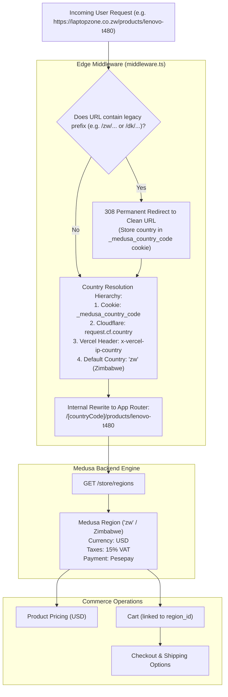

# Country & Location Architecture

> **Scope**: Geolocation detection, routing normalization, Medusa region mapping, currency/tax resolution, and delivery address handling for Laptopzone.

---

## 1. Architectural Resolution Model

Laptopzone operates primarily in Zimbabwe (`zw`), with support for regional and international customers. The application uses a **clean-URL strategy** publicly, with **internal route rewrites** based on geolocation and cookies.

---

## 2. Country vs. Region vs. Location Entities

It is critical to distinguish between the four different concepts in the codebase:

| Entity | Concept | Representation in Code | Scope & Purpose |
|---|---|---|---|
| **Country** | Geographic sovereign territory | ISO-2 lowercase string (`"zw"`, `"us"`, `"gb"`, `"za"`) | Used by the user agent, Edge geolocation headers, and address validation. |
| **Medusa Region** | Commerce rule set | `StoreRegion` object (`id: "reg_..."`, `currency_code: "usd"`, `countries: ["zw"]`) | Governs currencies, pricing rules, tax rates, and active payment providers. |
| **Customer Location** | IP or cookie-detected user location | `_medusa_country_code` cookie | Determines which currency and localized product availability to show the browsing visitor. |
| **Delivery Location** | Physical shipping destination | `Address` entity (`address_1`, `city`, `postal_code`, `country_code`) | Collected during checkout step 1. Determines shipping option availability and tax calculation. |

---

## 3. Country Resolution Hierarchy

When a request arrives at [`apps/storefront/src/middleware.ts`](file:///c:/Users/kundai/Desktop/projects/my-medusa-store/apps/storefront/src/middleware.ts):

1. **Cookie Inspection**: Checks for `_medusa_country_code`. If present and valid within Medusa's active regions, it is used immediately.
2. **CDN Geolocation**:
   - Cloudflare Workers: `request.cf.country`
   - Vercel Edge: `x-vercel-ip-country`
3. **Application Fallback**:
   - `DEFAULT_COUNTRY` = `"zw"` (Zimbabwe)
   - `DEFAULT_REGION` from environment (`process.env.NEXT_PUBLIC_DEFAULT_REGION` || `"dk"`)
4. **Clean URL Preservation**:
   - If a visitor or crawler navigates to `/zw/products/...` directly, the middleware issues an **HTTP 308 permanent redirect** to `/products/...` while preserving the country selection in the cookie.
   - The Next.js App Router internally maps the clean URL to the `[countryCode]` dynamic folder (`apps/storefront/src/app/[countryCode]/(main)`).

---

## 4. Current Delivery Location Handling

In the current checkout flow (`apps/storefront/src/modules/checkout`):
- Delivery location is collected as a standard shipping address form (`first_name`, `last_name`, `company`, `address_1`, `address_2`, `city`, `postal_code`, `province`, `phone`).
- Country defaults to Zimbabwe (`ZW`).
- Shipping options are retrieved from the backend Fulfillment module linked to the region's warehouse stock location.

---

## 5. Future Architecture / Planned Features

The following features have been identified for future implementation but **are not currently present** in the repository:

### 5.1 Hierarchical Town & City Delivery Selection
- **Status**: `PLANNED / NOT YET IMPLEMENTED`
- **Goal**: Instead of free-form city text fields, provide a structured Zimbabwean dropdown selector (e.g., Harare, Bulawayo, Chitungwiza, Mutare, Gweru, Kwekwe, Victoria Falls) with specific suburban delivery zones.
- **Planned Integration**:
  - Custom Medusa fulfillment service module mapping shipping rates dynamically by town/suburb.
  - Storefront checkout address step UI with cascading select controls.
