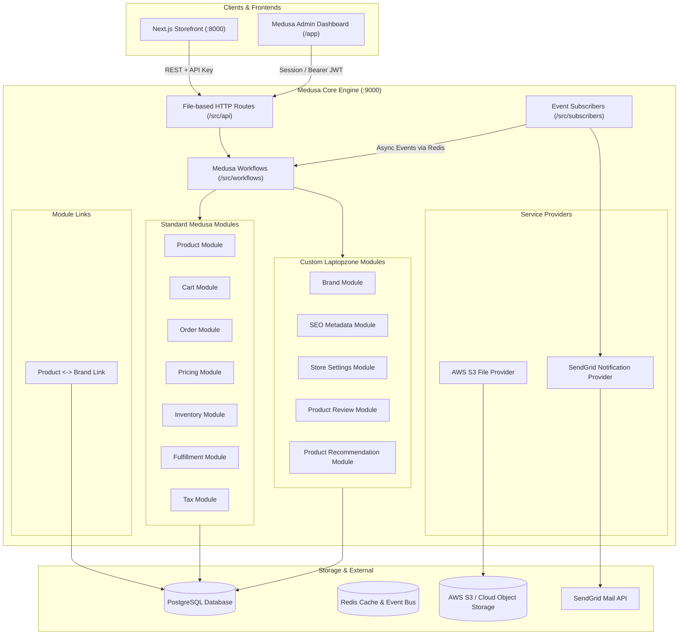

# Medusa Backend Architecture

> **Application**: `@dtc/backend`  
> **Framework**: Medusa v2 (`@medusajs/medusa` ^2.5.1, `@medusajs/framework` ^2.5.1)  
> **Runtime**: Node.js 20+ (CI uses Node 22.22.1), PostgreSQL 15+  
> **Source Directory**: `apps/backend/src`

---

## 1. Architectural Overview

Laptopzone uses Medusa v2 as a headless e-commerce engine operating in a monorepo workspace alongside the Next.js storefront. Medusa manages commerce primitives (catalog, pricing, inventory, cart, checkout, orders, customers, and taxes) and is extended with custom domain modules, workflows, event subscribers, and admin UI widgets.



---

## 2. Standard Medusa vs. Laptopzone Custom Functionality

| Capability | Standard Medusa v2 | Laptopzone Custom Implementation |
|---|---|---|
| **Catalog Hierarchy** | Categories, Collections, Tags | Added custom **Brand Module** (`src/modules/brand`) linked via module link `product-brand.ts`. |
| **Product Attributes** | Standard metadata JSON field | Added dedicated **SEO Metadata Module** (`src/modules/seo`), **Product Reviews** (`src/modules/product-review`), and **Recommendations** (`src/modules/product-recommendation`). |
| **Payments** | Providers enabled in Medusa configuration | Payment provider integrations are not bundled with this application. |
| **Notifications** | Local console or generic notification | Custom **SendGrid Notification Provider** (`src/modules/sendgrid`) with transactional HTML templates for orders, admin alerts, invites, and password resets. |
| **Media / File Storage** | Local static filesystem | Production uses `@medusajs/medusa/file-s3` pointing to S3-compatible cloud storage. |
| **Store Settings** | Hardcoded or basic store name | Custom **Store Settings Module** (`src/modules/store-settings`) storing notification emails, brand metadata, and operational configs in Postgres. |
| **Catalog Migration** | Manual CSV import | Custom **WooCommerce Product Importer** and **Yoast SEO Importer** workflows and admin UI pages. |
| **Cache Synchronization** | In-memory / internal cache | Event subscriber `storefront-cache-invalidation.ts` firing secure webhook calls to Next.js `revalidateTag()`. |

---

## 3. Custom Modules & Data Models

Custom modules are registered in [`medusa-config.ts`](file:///c:/Users/kundai/Desktop/projects/my-medusa-store/apps/backend/medusa-config.ts) and located in `apps/backend/src/modules`.

### 3.1 Brand Module (`src/modules/brand`)
- **Model**: `Brand` (`models/brand.ts`)
  - `id`: Primary key (text)
  - `name`: Brand title (e.g., "Lenovo", "Dell", "HP", "Apple")
  - `handle`: Unique URL-friendly slug (e.g. `lenovo`)
  - `description`: Textual summary
  - `logo_url`: Remote or S3 image URL
  - `website_url`: External manufacturer URL
  - `metadata`: Flexible JSON metadata
- **Module Link**: `apps/backend/src/links/product-brand.ts` links `Product` (`Modules.PRODUCT`) with `Brand` (`brandModuleService`).

### 3.2 SEO Metadata Module (`src/modules/seo`)
- **Model**: `SeoMetadata` (`models/seo-metadata.ts`)
  - `id`: Primary key
  - `entity_type`: Polymorphic type (`product`, `category`, `brand`)
  - `entity_id`: Foreign identifier of the entity
  - `meta_title`, `meta_description`, `focus_keyphrase`
  - `canonical_url`, `og_title`, `og_description`, `og_image`
  - `robots_index` (boolean, default true), `robots_follow` (boolean, default true)
  - `metadata`: JSON storage
  - Unique composite index on `(entity_type, entity_id)`.

### 3.3 Product Recommendation Module (`src/modules/product-recommendation`)
- **Model**: `ProductRecommendation` (`models/product-recommendation.ts`)
  - Handles curated upsells, cross-sells, related accessories, and laptop bundles per product with rank/ordering support.

### 3.4 Product Review Module (`src/modules/product-review`)
- **Model**: `Review` (`models/review.ts`)
  - Customer product reviews with rating (1-5), review title, content, verified buyer status, and approval workflow status (`pending`, `approved`, `rejected`).

### 3.5 Store Settings Module (`src/modules/store-settings`)
- **Model**: `StoreSettings` (`models/store-settings.ts`)
  - Singleton configuration record storing order alert email recipients, admin dashboard URL, support contact details, and custom store properties.

---

## 4. Custom Workflows

Business logic is encapsulated inside Medusa workflows located under `apps/backend/src/workflows`:

```text
apps/backend/src/workflows/
├── create-brand.ts
├── update-brand.ts
├── delete-brand.ts
├── link-product-brand.ts
├── create-product-review.ts
├── update-product-review.ts
├── delete-product-review.ts
├── create-product-recommendation.ts
├── update-product-recommendation.ts
├── delete-product-recommendation.ts
├── reorder-product-recommendations.ts
├── generate-product-feed.ts
├── set-store-settings.ts
├── upsert-entity-seo.ts
├── upsert-product-seo.ts
├── import-woocommerce-products.ts
└── import-yoast-seo.ts
```

### Key Workflows:
1. **`generateProductFeedWorkflow`**: Reads the catalog, cleans descriptions, validates variants, calculates pricing, resolves brand links, and produces Google Merchant Center XML.
3. **`importWooCommerceProductsWorkflow`**: Connects to legacy WooCommerce REST API, maps products, creates categories/variants, downloads media to S3, and links SEO metadata.
4. **`importYoastSeoWorkflow`**: Extracts Yoast SEO meta from WordPress and populates the `seo_metadata` table for matching handles.

---

## 5. Event Subscribers

Subscribers listen to internal events dispatched across the Medusa event bus (Redis):

| Subscriber File | Subscribed Events | Triggered Actions |
|---|---|---|
| `order-placed.ts` | `order.placed` | Compiles order totals, fetches line items, and dispatches customer confirmation email and store admin alerts via SendGrid. |
| `order-payment-captured.ts` | `order.payment_captured` | Notifies customer of confirmed payment capture. |
| `order-fulfillment-created.ts` | `order.fulfillment_created` | Sends shipping confirmation with tracking information. |
| `customer-created.ts` | `customer.created` | Dispatches welcome notification to new customer. |
| `auth-password-reset.ts` | `auth.password_reset` | Sends secure password reset link to user. |
| `invite-created.ts` | `invite.created` | Sends team invite link to new admin staff. |
| `storefront-cache-invalidation.ts` | `product.*`, `product-variant.*`, `product-category.*`, `product-collection.*`, `inventory.*`, `price-list.*` | Sends an authenticated POST request to Next.js `/api/revalidate` to bust ISR cache tags. |

---

## 6. Admin Dashboard Extensions

Laptopzone heavily extends Medusa's standard Vite-powered admin dashboard (`src/admin`):

- **Routes**:
  - `/app/brands`: Complete Brand management interface (add, edit, delete, assign logos).
  - `/app/bulk-products`: Batch product editor (status, category, brand, and pricing).
  - `/app/settings/branding`: Store logo, favicon, and login page branding.
  - `/app/settings/order-notifications`: Notification recipient emails and SendGrid test mailer.
  - `/app/woocommerce-migrator`: WordPress/WooCommerce live import console.
  - `/app/yoast-seo-importer`: Yoast SEO migration tools.
  - `/app/home-showcase`: Curated homepage showcase manager.
- **Widgets**:
  - `product-brand-widget.tsx`: Brand dropdown embedded directly inside the Product details view.
  - `product-seo-widget.tsx`: Meta title, description, focus keyword, and Google SERP preview directly on product pages.
  - `category-seo-widget.tsx`: SEO customization for product categories.
  - `product-reviews-widget.tsx`: Moderate and approve customer reviews per product.
  - `product-recommendations-widget.tsx`: Drag-and-drop recommended products.
  - `product-media-picker.tsx`: Advanced image management tool.
  - `customer-wishlist.tsx`: Customer profile widget showing items saved in user wishlists.
