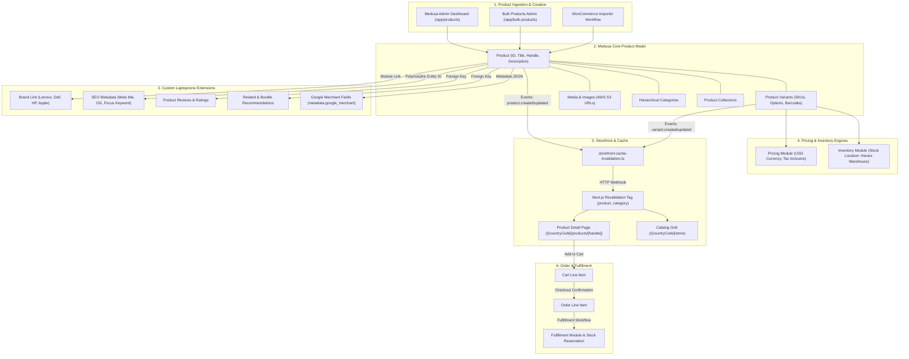

# Product Architecture & Lifecycle

> **Scope**: Complete architecture of the Laptopzone product catalog, data modeling, custom attribute links, inventory, pricing, and lifecycle from creation to customer fulfillment.

---

## 1. Product Lifecycle Overview

---

## 2. Product Data Model & Storage Locations

Every entity in the Laptopzone catalog has a designated storage location in the PostgreSQL database:

| Component | Storage Location / Table | Identifiers & Attributes | Description |
|---|---|---|---|
| **Product** | `product` table (Core Product Module) | `id` (`prod_01...`), `handle`, `title`, `subtitle`, `description`, `thumbnail`, `status` (`published`/`draft`) | Root catalog record. `handle` is the URL slug used in storefront routing. |
| **Variants** | `product_variant` table | `id` (`variant_01...`), `title`, `sku`, `barcode`, `manage_inventory`, `allow_backorder` | Sellable SKUs. Laptops usually have one primary variant or multiple variants differentiated by RAM/SSD. |
| **Options** | `product_option`, `product_option_value` | `id` (`opt_01...`), `title` (e.g., "Memory", "Storage", "Condition"), `value` | Defines product variant attributes. |
| **Images** | `product_image` table | `id` (`img_01...`), `url`, `rank` | Public image URLs hosted on AWS S3 (`s3.amazonaws.com` or CloudFront CDN). |
| **Categories** | `product_category` table | `id` (`pcat_01...`), `name`, `handle`, `parent_category_id`, `rank` | Multi-level tree navigation (e.g. *Laptops -> Business Laptops -> ThinkPad*). |
| **Collections** | `product_collection` table | `id` (`pcol_01...`), `title`, `handle` | Curated groupings (e.g. *Featured Deals*, *Back to School*). |
| **Brand Link** | `product_brand` (Link Table) + `brand` module table | `id` (`brand_01...`), `name`, `handle`, `logo_url` | Established via Medusa Module Link between core Product and custom Brand module. |
| **SEO Metadata** | `seo_metadata` table | `entity_type = 'product'`, `entity_id = prod_id`, `meta_title`, `meta_description`, `canonical_url` | Custom SEO module storing search engine meta and OpenGraph configuration. |
| **Reviews** | `review` table | `id`, `product_id`, `customer_id`, `rating`, `title`, `content`, `status` | Customer reviews with 1-5 star ratings and admin approval state. |
| **Recommendations** | `product_recommendation` table | `id`, `product_id`, `recommended_product_id`, `rank`, `type` | Upsells, accessories (e.g., charger, laptop bag, dock). |
| **Pricing** | `price` table (Pricing Module) | `id`, `price_set_id`, `currency_code = 'usd'`, `amount`, `min_quantity`, `max_quantity` | Stored in cents (e.g. `$450.00` is stored as `45000` or numeric decimal depending on Medusa v2 version). |
| **Inventory** | `inventory_item`, `inventory_level` | `inventory_item_id`, `location_id`, `stocked_quantity`, `reserved_quantity` | Tracked against the primary warehouse stock location. |
| **Google Merchant** | `product.metadata.google_merchant` JSON | `condition`, `brand`, `gtin`, `mpn`, `google_product_category`, `availability` | Custom JSON attributes consumed by the Google Merchant feed generator. |

---

## 3. Product Variant & Option Strategy

Laptopzone specializes in laptops, accessories, and computing equipment. Catalog items fall into two variant strategies:

1. **Single-Variant Products**: Fixed-specification machines (e.g., *HP EliteBook 840 G6 - Core i5, 16GB RAM, 512GB SSD*). These have a single default variant whose SKU directly reflects the unit inventory.
2. **Multi-Variant Products**: Machines offered with selectable upgrade options (e.g., Option `RAM`: 8GB, 16GB, 32GB; Option `Storage`: 256GB SSD, 512GB SSD, 1TB SSD).

---

## 4. Media & Cloud Storage (AWS S3)

1. **Upload Mechanism**:
   - In the Medusa Admin (`/app`), users upload product photos via the `product-media-picker.tsx` widget or core product editor.
   - Files are piped to `@medusajs/medusa/file-s3` using the credentials in `apps/backend/.env`:
     - `S3_BUCKET`
     - `S3_REGION`
     - `S3_ACCESS_KEY_ID`
     - `S3_SECRET_ACCESS_KEY`
     - `S3_FILE_URL` / `S3_ENDPOINT`
2. **Next.js Storefront Optimization**:
   - The storefront uses Next.js Image component (`next/image`).
   - Image domains and patterns are whitelisted in `apps/storefront/next.config.js` to allow fast WebP/AVIF transformations.
   - An image proxy route exists at `apps/storefront/src/app/api/image-proxy/route.ts` to safely proxy external image assets for OpenGraph scrapers.

---

## 5. Pricing & Currency Resolution

- **Primary Currency**: `USD` (United States Dollar).
- **Default Region**: `zw` (Zimbabwe).
- **Tax Configuration**:
  - Tax region `zw` is configured with a 15% standard VAT rate.
  - Prices in the storefront are rendered using standard currency formatters from `@lib/util/prices`.

---

## 6. Catalog Ingestion & Migration

Catalog items enter the Medusa database through three primary mechanisms:

1. **Medusa Admin UI**:
   - Standard `/app/products` create/edit screens.
   - Extended with the custom `Bulk Products` editor (`/app/bulk-products`) allowing simultaneous updates to status, brand, categories, and prices.
2. **WooCommerce Product Migrator**:
   - Executable via script: `npx medusa exec ./src/scripts/import-woocommerce.ts`
   - Or triggered from Admin UI: `/app/woocommerce-migrator`
   - Maps WooCommerce attributes, categories, image attachments, and stock quantities into Medusa v2 data models.
3. **Yoast SEO Importer**:
   - Executable from Admin UI: `/app/yoast-seo-importer`
   - Transfers Yoast title tags, meta descriptions, and focus keyphrases into the `seo_metadata` table.
