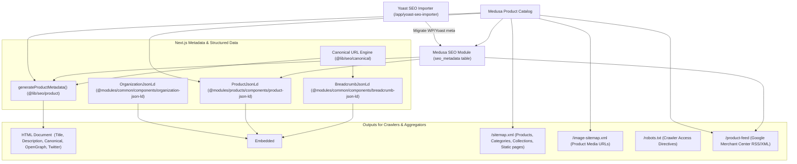

# SEO Architecture

> **Application**: `@dtc/storefront` & `@dtc/backend`  
> **Status**: Production-grade SEO implementation with custom Medusa module, Next.js dynamic metadata, Schema.org JSON-LD, multi-sitemap, and Google Merchant Center integration.

---

## 1. High-Level SEO Architecture

---

## 2. Core SEO Components & Implementations

### 2.1 Metadata, Titles, Descriptions, and OpenGraph
- **Engine**: Dynamic metadata generation in Next.js Server Components (`generateMetadata`).
- **File**: `apps/storefront/src/lib/seo/product.ts` and `metadata.ts`.
- **Precedence Hierarchy**:
  1. If `seo_metadata` exists in Medusa for the entity, `seo.meta_title` and `seo.meta_description` override default catalog values.
  2. If missing, automatically synthesized from `product.title`, primary category name, price, and site branding: `"${product.title} | Laptopzone Zimbabwe"`.
- **OpenGraph & Twitter Cards**:
  - `og:type`: `"website"` for standard pages, `"product"` for product detail pages.
  - `og:image`: Uses `seo.og_image` or primary product `thumbnail`, processed through Next.js image optimizer.
  - `twitter:card`: `"summary_large_image"`.

### 2.2 Canonical URL Engine
- **Implementation**: [`apps/storefront/src/lib/seo/canonical.ts`](file:///c:/Users/kundai/Desktop/projects/my-medusa-store/apps/storefront/src/lib/seo/canonical.ts)
- **Base Domain**: Configured via `NEXT_PUBLIC_BASE_URL` (default: `https://laptopzone.co.zw`).
- **Clean URL Normalization**:
  - Automatically strips country code prefixes from canonical URLs (e.g. outputs `https://laptopzone.co.zw/products/dell-latitude-7400` instead of `/zw/products/...`).
  - Ensures search engines index a single canonical URL for each resource, preventing duplicate content penalties across geographic regions.

### 2.3 Schema.org JSON-LD Structured Data

| Schema Type | Component Location | Target Pages | Key Properties Emitted |
|---|---|---|---|
| **Product & Offers** | `src/modules/products/components/product-json-ld/index.tsx` | PDP (`/products/[handle]`) | `@type: "Product"`, `name`, `image`, `description`, `sku`, `brand`, `offers: { @type: "Offer", price, priceCurrency: "USD", availability: "InStock"/"OutOfStock", url, seller: { @type: "Organization", name: "Laptopzone" } }` |
| **BreadcrumbList** | `src/modules/common/components/breadcrumb-json-ld/index.tsx` | PDP & Category Pages | `@type: "BreadcrumbList"`, hierarchical list with positions: `Home -> Category -> Product Title` |
| **OnlineStore / Organization** | `src/modules/common/components/organization-json-ld/index.tsx` | Global (`layout.tsx`) | `@type: "OnlineStore"`, `legalName: "Laptopzone"`, `logo`, `contactPoint: { telephone, email, areaServed: "ZW" }`, `sameAs: [facebook, instagram, twitter]` |

### 2.4 Robots.txt & Multi-Sitemap Architecture
- **Robots.txt**:
  - File: [`apps/storefront/src/app/robots.ts`](file:///c:/Users/kundai/Desktop/projects/my-medusa-store/apps/storefront/src/app/robots.ts)
  - Allows public indexable routes (`/`, `/products/`, `/categories/`, `/brands/`, `/collections/`, `/store`).
  - Disallows private and checkout routes (`/cart`, `/checkout`, `/account`, `/search`, `/wishlist`, `/api/`).
  - Declares references to both sitemaps:
    - `https://laptopzone.co.zw/sitemap.xml`
    - `https://laptopzone.co.zw/image-sitemap.xml`
- **Primary Sitemap**:
  - File: [`apps/storefront/src/app/sitemap.ts`](file:///c:/Users/kundai/Desktop/projects/my-medusa-store/apps/storefront/src/app/sitemap.ts)
  - Dynamically queries products, categories, collections, and brands.
  - Emits `lastModified`, `changeFrequency`, and priority weights (`1.0` for home, `0.9` for shop, `0.8` for products, `0.7` for categories/brands).
- **Image Sitemap**:
  - Route: [`apps/storefront/src/app/image-sitemap.xml/route.ts`](file:///c:/Users/kundai/Desktop/projects/my-medusa-store/apps/storefront/src/app/image-sitemap.xml/route.ts)
  - Google-specific image XML extension mapping every product image, caption, and title for Google Images indexing.

---

## 3. Google Merchant Center Feed

The Medusa backend includes a native Google Merchant Center feed generator:
- **Endpoints**: `GET /product-feed` and `GET /store/product-feed`
- **Workflow**: `generateProductFeedWorkflow` (`apps/backend/src/workflows/generate-product-feed.ts`)
- **Mapping Logic** (`map-product-to-feed-item.ts`):
  - `g:id`: Product or Variant ID (`prod_...` / `variant_...`)
  - `g:title`: Cleaned, HTML-stripped title with variant specifications
  - `g:description`: Clean plain text stripped of HTML tags
  - `g:link`: Canonical product URL
  - `g:image_link` & `g:additional_image_link`: S3 image URLs
  - `g:price`: Current price formatted with currency (e.g., `450.00 USD`)
  - `g:availability`: `in_stock` / `out_of_stock` based on inventory levels
  - `g:brand`: Resolved via the Medusa Product-Brand module link
  - `g:condition`: Custom metadata or defaults to `refurbished` / `new`
  - `g:google_product_category` & `g:mpn`: Pulled from `product.metadata.google_merchant`
- **Diagnostics**: Calling `GET /product-feed?format=json` outputs item count and diagnostic validation warnings before syncing with Google Merchant Center.

---

## 4. Legacy URL Preservation & Rewriting

To preserve rankings and backlinks from the previous WooCommerce site:
- **Mapping Table**: [`apps/storefront/src/lib/seo/legacy-url-map.json`](file:///c:/Users/kundai/Desktop/projects/my-medusa-store/apps/storefront/src/lib/seo/legacy-url-map.json)
- **Middleware Execution**: [`apps/storefront/src/middleware.ts`](file:///c:/Users/kundai/Desktop/projects/my-medusa-store/apps/storefront/src/middleware.ts)
  - Traps legacy URLs like `/product/lenovo-thinkpad-t480/` and transparently rewrites them internally to `/products/lenovo-thinkpad-t480`.
  - Traps legacy category hierarchy paths and rewrites them to the new category structure without 404 errors.
