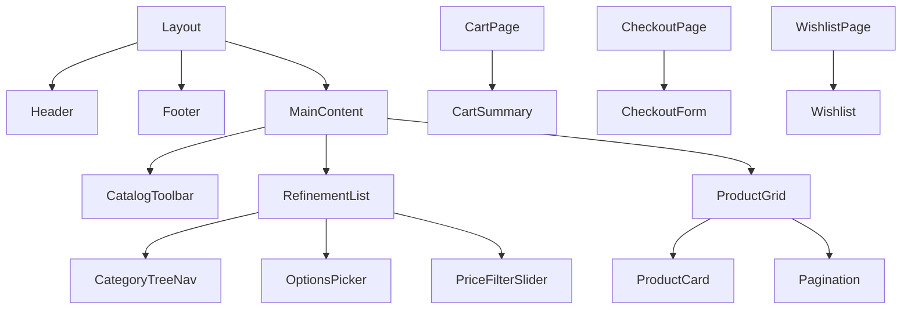

# Storefront Routing & Components

> **Scope** – This document covers the **Next.js App Router** routes and the most important reusable UI components in the Laptopzone storefront (`apps/storefront`).  It reflects the current codebase; no assumptions are made about missing features.

---

## 1. Overview

The storefront lives under `apps/storefront/src/app`.  It uses a **dynamic country‑code segment** (`[countryCode]`) that prefixes most user‑facing pages.  Inside the `([main])` segment are the public pages, while the `([checkout])` segment contains the checkout flow.

### High‑level route hierarchy (Mermaid)

```mermaid
flowchart TD
    subgraph CountryPrefix["/[countryCode]"]
        Main((main))
        Checkout((checkout))
    end
    Main --> Home[/]
    Main --> Store[/store]
    Main --> Cart[/cart]
    Main --> Products[/products/:handle]
    Main --> Categories[/categories/...]
    Main --> Collections[/collections/:handle]
    Main --> Brands[/brands]
    Main --> Wishlist[/wishlist]
    Main --> Account[/account]
    Main --> Order[/order/:id]
    Main --> Returns[/returns]
    Main --> Shipping[/shipping]
    Main --> Terms[/terms]
    Main --> Privacy[/privacy]
    Main --> Warranty[/warranty]
    Main --> VerifyAccount[/verify-account]
    Checkout --> CheckoutPage[/checkout]
```

---

## 2. Route Table

| Route (URL pattern) | Source file | Purpose | Notes |
|---------------------|-------------|---------|-------|
| `/[countryCode]/` | `apps/storefront/src/app/[countryCode]/(main)/page.tsx` | Home page showing featured products. | Uses `store` module components for product list. |
| `/[countryCode]/store` | `apps/storefront/src/app/[countryCode]/(main)/store/page.tsx` | General store/browser page (product grid). | Renders `catalog-toolbar`, `refinement-list`, and `pagination`. |
| `/[countryCode]/cart` | `apps/storefront/src/app/[countryCode]/(main)/cart/page.tsx` | Shopping cart view. | Displays cart items, totals, and checkout button. |
| `/[countryCode]/checkout` | `apps/storefront/src/app/[countryCode]/(checkout)/checkout/page.tsx` | Checkout flow entry point. | Wrapped by `checkout` layout that loads payment providers. |
| `/[countryCode]/products/:handle` | `apps/storefront/src/app/[countryCode]/(main)/products/[handle]/page.tsx` | Product detail page. | Fetches product via Medusa SDK, renders SEO meta tags. |
| `/[countryCode]/categories/**` | `apps/storefront/src/app/[countryCode]/(main)/categories/[...category]/page.tsx` | Category browsing (deep nest). | `...category` is a catch‑all for hierarchical categories. |
| `/[countryCode]/collections/:handle` | `apps/storefront/src/app/[countryCode]/(main)/collections/[handle]/page.tsx` | Collection page. |
| `/[countryCode]/brands` | `apps/storefront/src/app/[countryCode]/(main)/brands/page.tsx` | Brand listing. |
| `/[countryCode]/brands/:handle` | `apps/storefront/src/app/[countryCode]/(main)/[handle]/page.tsx` | Brand detail page. |
| `/[countryCode]/wishlist` | `apps/storefront/src/app/[countryCode]/(main)/wishlist/page.tsx` | User wishlist (requires auth). |
| `/[countryCode]/account` | `apps/storefront/src/app/[countryCode]/(main)/account/@dashboard/page.tsx` | Account dashboard home. |
| `/[countryCode]/account/profile` | `apps/storefront/src/app/[countryCode]/(main)/account/profile/page.tsx` | Profile editing. |
| `/[countryCode]/account/addresses` | `apps/storefront/src/app/[countryCode]/(main)/account/addresses/page.tsx` | Manage shipping addresses. |
| `/[countryCode]/account/orders` | `apps/storefront/src/app/[countryCode]/(main)/account/orders/page.tsx` | List of past orders. |
| `/[countryCode]/account/orders/:id` | `apps/storefront/src/app/[countryCode]/(main)/account/orders/details/[id]/page.tsx` | Order detail view. |
| `/[countryCode]/order/:id/confirmed` | `apps/storefront/src/app/[countryCode]/(main)/order/confirmed/[id]/page.tsx` | Order confirmation screen after payment. |
| `/[countryCode]/order/:id/transfer/:token/accept` | `apps/storefront/src/app/[countryCode]/(main)/order/[id]/transfer/[token]/accept/page.tsx` | Handles payment‑provider redirects (accept). |
| `/[countryCode]/order/:id/transfer/:token/decline` | `apps/storefront/src/app/[countryCode]/(main)/order/[id]/transfer/[token]/decline/page.tsx` | Handles payment‑provider redirects (decline). |
| `/[countryCode]/payment-callback` | `apps/storefront/src/app/[countryCode]/(main)/payment-callback/page.tsx` | Generic payment callback endpoint. |
| `/[countryCode]/privacy` | `apps/storefront/src/app/[countryCode]/(main)/privacy/page.tsx` | Privacy policy page. |
| `/[countryCode]/terms` | `apps/storefront/src/app/[countryCode]/(main)/terms/page.tsx` | Terms & conditions. |
| `/[countryCode]/warranty` | `apps/storefront/src/app/[countryCode]/(main)/warranty/page.tsx` | Warranty information. |
| `/[countryCode]/verify-account` | `apps/storefront/src/app/[countryCode]/(main)/verify-account/page.tsx` | Email verification flow. |
| `/[countryCode]/returns` | `apps/storefront/src/app/[countryCode]/(main)/returns/page.tsx` | Returns policy page. |
| `/[countryCode]/shipping` | `apps/storefront/src/app/[countryCode]/(main)/shipping/page.tsx` | Shipping information page. |
| `/[countryCode]/contact` | `apps/storefront/src/app/[countryCode]/(main)/contact/page.tsx` | Contact form (uses `contact-form.tsx`). |
| `/[countryCode]/cookies` | `apps/storefront/src/app/[countryCode]/(main)/cookies/page.tsx` | Cookie policy. |
| `/api/image-proxy` | `apps/storefront/src/app/api/image-proxy/route.ts` | Proxy for remote images (used by OpenGraph). |
| `/api/revalidate` | `apps/storefront/src/app/api/revalidate/route.ts` | On‑demand ISR revalidation endpoint. |
| `/api/search` | `apps/storefront/src/app/api/search/route.ts` | Server‑side search API used by the storefront. |
| `/image-sitemap.xml` | `apps/storefront/src/app/image-sitemap.xml/route.ts` | Dynamically generated image sitemap for SEO. |

**Note** – All routes are **GET**‑only; data fetching is performed via React Server Components or the Medusa SDK client hooks.

---

## 3. Key UI Components

| Component | Location | Responsibility | Important Props |
|-----------|----------|----------------|----------------|
| **CatalogToolbar** | `apps/storefront/src/modules/store/components/catalog-toolbar/index.tsx` | Renders sorting dropdown, view‑mode toggle, and result count. | `sortOptions`, `currentSort`, `onSortChange` |
| **Pagination** | `apps/storefront/src/modules/store/components/pagination/index.tsx` | Page navigation UI for product lists. | `currentPage`, `totalPages`, `onPageChange` |
| **RefinementList** (wrapper) | `apps/storefront/src/modules/store/components/refinement-list/index.tsx` | Container for filtering controls (category tree, price slider, option pickers). | `filters`, `onFilterChange` |
| – **CategoryTreeNav** | `apps/storefront/src/modules/store/components/refinement-list/category-tree-nav/index.tsx` | Hierarchical category navigation. | `categories`, `selectedPath`, `onSelect` |
| – **OptionsPicker** | `apps/storefront/src/modules/store/components/refinement-list/options-picker/index.tsx` | Attribute‑based variant filters (size, color, etc.). | `options`, `selected`, `onSelect` |
| – **PriceFilterSlider** | `apps/storefront/src/modules/store/components/refinement-list/price-filter-slider/index.tsx` | Min‑max price range selector. | `min`, `max`, `value`, `onChange` |
| – **SortProducts** | `apps/storefront/src/modules/store/components/refinement-list/sort-products/index.tsx` | Dropdown for sort order (price low‑high, newest, etc.). | `options`, `selected`, `onSelect` |
| **ProductCard** | `apps/storefront/src/modules/products/components/product-card/index.tsx` | Small preview used on grid/list pages. | `product`, `onAddToCart` |
| **ProductDetail** | `apps/storefront/src/modules/products/components/product-detail/index.tsx` | Full product page layout, includes image gallery, description, and add‑to‑cart. | `product`, `variants`, `onAddToCart` |
| **CartSummary** | `apps/storefront/src/modules/cart/components/cart-summary/index.tsx` | Shows line items, subtotal, taxes, and checkout button. | `cart`, `onUpdateQuantity`, `onRemoveItem` |
| **CheckoutForm** | `apps/storefront/src/modules/checkout/components/checkout-form/index.tsx` | Collects shipping address, selects payment method, and places order. | `order`, `onSubmit` |
| **Wishlist** | `apps/storefront/src/modules/wishlist/components/wishlist/index.tsx` | Displays saved items; allows moving to cart. | `items`, `onRemove`, `onMoveToCart` |
| **Layout** (root) | `apps/storefront/src/app/layout.tsx` | Global layout – header, footer, Google Analytics injection. | `children` |
| **Header** | `apps/storefront/src/modules/common/components/header/index.tsx` | Site navigation, logo, mini‑cart badge. | `user`, `cartCount` |
| **Footer** | `apps/storefront/src/modules/common/components/footer/index.tsx` | Links, copyright, secondary navigation. | — |

### Component hierarchy (simplified)



---

## 4. How to Extend / Modify

1. **Add a new page**
   - Create a folder under `apps/storefront/src/app/[countryCode]/(main)` (or `(checkout)` if it belongs to the checkout flow).
   - Add a `page.tsx` file exporting a React Server Component.
   - Optionally add a `layout.tsx` if the page needs its own nested layout.
2. **Update navigation**
   - The global navigation lives in `modules/common/components/header`.  Add a link component and update the `navItems` array.
3. **Reuse a UI component**
   - Import the component via its absolute path, e.g. `import { CatalogToolbar } from "@/modules/store/components/catalog-toolbar"`.
   - Ensure any required props are passed; refer to the component table above.
4. **Add a server‑side API route**
   - Place a `route.ts` file under `apps/storefront/src/app/api/<name>/`.
   - Export HTTP method handlers (`GET`, `POST`, …) as per Next.js App Router conventions.

---

## 5. References

- Root layout: [`layout.tsx`](file:///c:/Users/kundai/Desktop/projects/my-medusa-store/apps/storefront/src/app/layout.tsx)
- Store module components: see the component table for individual file links.
- API routes: [`api/search/route.ts`](file:///c:/Users/kundai/Desktop/projects/my-medusa-store/apps/storefront/src/app/api/search/route.ts)

---

*Documentation generated on 2026‑10‑05.*
